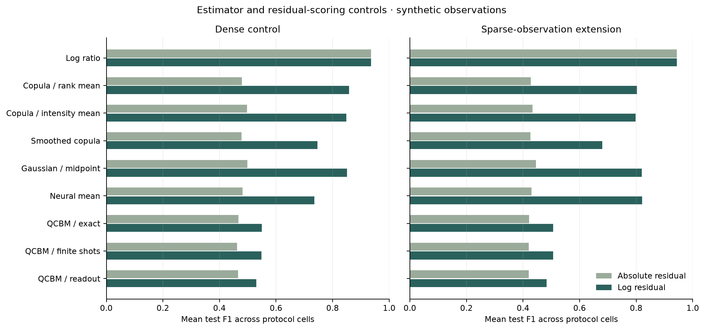
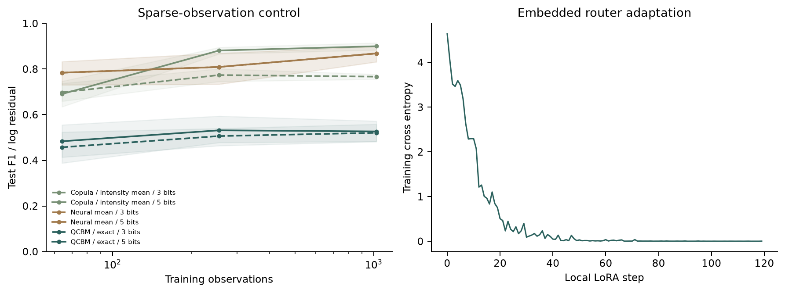

# Conditional Estimands, Residual Scoring, and Sampling in Change Detection

Michele Giletto · System Labs · 20 October 2026

**Status: manuscript draft accompanying software version 0.1.0. Not peer reviewed.**

## Abstract

Generative conditional background estimation combines a learned dependence model, marginal transformations, a conditional functional and a detector score. These choices can affect performance independently. We introduce a reproducible simulation benchmark that holds several of them fixed while comparing empirical, smoothed, Gaussian, neural and quantum-circuit estimators. A dense control and a sparse-observation extension each contain 90 fitted configurations; each fit is evaluated with two residual scorers. A separate 30-run monotone-transform control preserves rank-space observations and the fitted quantum distribution in every tested case. Thresholds and spatial windows are selected using calibration scenes and frozen before testing. In the included multiplicative lognormal generator, a log-ratio detector is a strong reference, and the small quantum circuit does not establish an advantage over classical alternatives. The accompanying application executes bounded research procedures using a locally adapted open-weight language model and exports complete inference bundles. These results concern synthetic observations and do not establish satellite, medical or physical-QPU performance.

## 1. Motivation and prior work

Sekwao et al. [1] report QCBM-based background estimation on Capella SAR/coherence data and IonQ hardware. Their result motivates investigating which parts of a generative-estimation pipeline produce useful changes in detection. Interval implements a smaller independent simulator, rather than reproducing the original hardware experiment or its headline scores. Quantum-versus-classical generative comparisons have prior methodological literature [2], and neural copula models also predate this work [3].

The written classical and quantum methods in [1] appear to describe different averaging orders around the inverse marginal transform. This is an inference from the manuscript, not a verified implementation error. The present study makes the distinction explicit and tests it under common observations and joint distributions.

## 2. Estimands

Let U=F_X(X) and V=F_Y(Y). The rank-space estimator F_Y^(-1)(E[V|U]) is generally different from E[F_Y^(-1)(V)|U]. The latter is the original-intensity conditional mean. A discrete copula model is evaluated using the same inverse-quantile bin representatives and row-wise intensity expectation for every fitted joint distribution. The rank-mean alternative is an explicit ablation of the empirical copula only.

The experiment also separates absolute-intensity and absolute-log residual scoring. Log ratio uses the unmodified before image as its reference background and remains a separate detector baseline. Changing a scorer can change a detector's ranking without changing its fitted dependence model.

## 3. Protocol

The complete generator, fitting, calibration and interval definitions are in [research-protocol.md](research-protocol.md). Each seed group has independent training, calibration and test scenes. No training change label is provided to fitting. Ten seed groups are used per protocol cell. The dense control varies three tail/dependence regimes and three discretizations with 3,072 training observations. The sparse extension fixes one regime and varies 64, 256 and 1,024 training observations at the same three discretizations. These regimes have different numbers of observations per conditioning bin; sparse joint occupancy and empty row support are reported separately.

Tail strength also changes dependence because additive log noise is held fixed; the tail sweep is not an isolated causal test of marginal tails. The supplementary fixed-observation control applies strictly monotone powers 0.5, 1 and 2. Its transformed analytic background expectation includes the transformed noise variance rather than raising the old expectation to a power.

The QCBM uses 6, 8 or 10 qubits, two local-unitary layers per register and 80 Adam steps with exact probability gradients. Inference controls use finite multinomial measurements and an explicitly limited terminal bit-flip model. This is distinct from the optimizer, shot budgets, circuit size and physical processors in [1].

## 4. Measured results

The table contains descriptive averages of test F1 over the 90 configurations in each suite. Cells reuse fixed seed groups, so the 90 values are not treated as 90 independent population samples. Per-cell seed-group bootstrap intervals and paired differences are retained in the machine-readable evidence. Intervals are exploratory and uncorrected for multiple comparisons.

| Detector / fitted background | Dense / absolute | Dense / log | Sparse / absolute | Sparse / log |
| --- | ---: | ---: | ---: | ---: |
| Log ratio | 0.9361 | 0.9361 | 0.9437 | 0.9437 |
| Copula / rank mean | 0.4788 | 0.8576 | 0.4269 | 0.8031 |
| Copula / intensity mean | 0.4971 | 0.8479 | 0.4336 | 0.7984 |
| Smoothed copula | 0.4781 | 0.7465 | 0.4267 | 0.6803 |
| Gaussian / midpoint | 0.4992 | 0.8512 | 0.4451 | 0.8199 |
| Neural mean | 0.4815 | 0.7360 | 0.4298 | 0.8206 |
| QCBM / exact | 0.4673 | 0.5495 | 0.4209 | 0.5060 |
| QCBM / finite shots | 0.4620 | 0.5483 | 0.4199 | 0.5067 |
| QCBM / readout | 0.4658 | 0.5299 | 0.4202 | 0.4828 |

The log-ratio reference is particularly effective because changes in this generator are multiplicative and the unchanged relation is nearly linear in log intensity. This is a property of the selected simulation, not a universal recommendation. For the dense control, changing the empirical copula's averaging order changes mean absolute-residual F1 from 0.4788 to 0.4971; with log residuals the corresponding values are 0.8576 and 0.8479. Thus the intensity-mean choice does not uniformly improve detection, despite its different estimation interpretation.

All 30 monotone-transform runs retain identical empirical rank joint distributions and fitted quantum probabilities within the declared numerical tolerance. Detection and intensity-estimation outputs can still change because inverse marginal representatives and scoring change. The control therefore demonstrates why an unchanged copula alone cannot establish detector invariance.

The small-circuit QCBM does not dominate the included baselines. This negative result does not refute [1]: datasets, circuit expressivity, optimizers, preprocessing and evaluation all differ. It does establish that this software does not substantiate a quantum-advantage claim.

## 5. Model-assisted execution

SmolLM2-135M-Instruct [4], at a pinned revision, selects one of four predefined procedures using length-normalized candidate likelihood. A rank-8 LoRA adapter was trained on 96 synthetic requests for 120 steps. On 32 template-held-out requests containing action phrases already seen during training, selection accuracy changed from 28.125% to 100.0%. This is bounded intent selection; valid schema is guaranteed by the candidate set. No general planning, discovery or unrestricted tool-use claim follows.

Native execution validates the recipe, fits models, calibrates detectors and archives observations of completion. Numerical estimator performance is evaluated separately from language-to-procedure routing. A complete inference export contains network weights, marginal arrays, normalization and lookup tables. This release supports a single local user; institutional authentication and tenant qualification are separate development requirements.

## 6. Limitations and next studies

The generator omits radar physics and biology. Its change process favors multiplicative detectors. Training and test share the same generative family. The network is small and the Gaussian baseline uses conditioning-bin midpoints. No broad hyperparameter search is performed, and compute budgets differ in meaning between models. Quantum training uses exact gradients; only inference measurements are varied. The readout channel is not a hardware noise emulator. Whole-experiment timing cannot support per-method speed claims.

Next studies should add independent real acquisitions or patient-level image data, low-change negative controls, alternative dependence families, matched model-search budgets, transfer across acquisition/site conditions and physically justified noise. A clinical or geospatial conclusion requires its own data provenance and specialist validation. No priority claim is made for the estimator identity, copula modeling or orchestration design. The contribution at this stage is the inspectable implementation, controlled ablations and negative/positive simulation evidence.

## 7. Availability

[Source](https://github.com/michelegiletto-beep/interval-research) · [Executable demonstration](https://huggingface.co/spaces/Magic51/interval-research) · [System Labs](https://giletto-systems-lab.michele-giletto.chatgpt.site).

New code and synthetic data are Apache 2.0. Upstream weights retain their own attribution. No original Capella images or clinical observations are redistributed. The numerical implementation fingerprint is `21ad08c6a52090c1f5a33a51126508dd8307fa644b5a8994a9c0d5ed52c7bed1`.

## References

1. Sekwao et al. (2026). SAR and InSAR Change Detection with Quantum Generative Models. https://arxiv.org/abs/2609.05313
2. Hibat-Allah et al. (2024). A framework for demonstrating practical quantum advantage: comparing quantum against classical generative models. https://www.nature.com/articles/s42005-024-01552-6
3. Copula-based normalizing-flow research. https://arxiv.org/abs/2107.07352
4. Allal et al. (2025). SmolLM2: When Smol Goes Big. https://arxiv.org/abs/2502.02737
